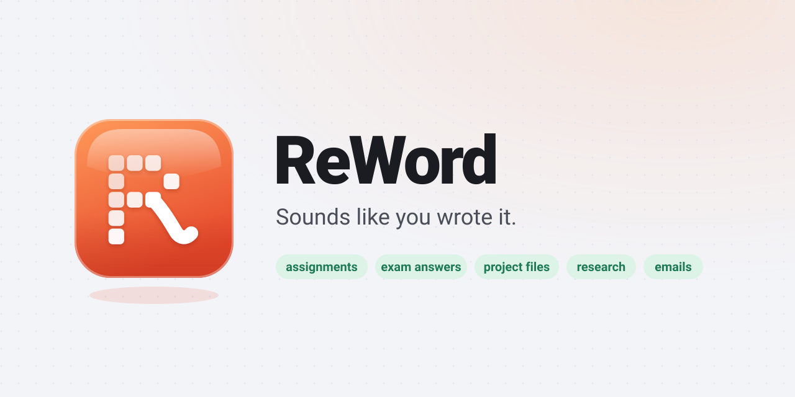

<p align="center">
  
</p>

<p align="center">
  <a href="LICENSE"></a>
  
  
  
  <a href="https://reword.1619.in"></a>
</p>

AI text is easy to spot. It *delves*, it calls everything *pivotal*, it says "it's not just X, it's Y", and its grammar is a little too perfect. **ReWord** is a skill for Claude (and any AI that takes instructions) that writes the way a real person writes: plain words, specific facts, uneven rhythm, and, if you want, your own habits.

<p align="center">
  
</p>

## What's inside

| | Skill | What it does |
|---|---|---|
|  | **reword** | Writes and rewrites assignments, exam answers, project files, research papers, reports, documents, emails, and posts. Learns your style. Checks text for AI patterns. |
|  | **tiny-tale** | Explains any hard topic with a 100-word story a 5-year-old could follow, then maps it back to the real terms. |

## Install

Pick the one you use. Each takes under a minute.

**Claude Code** (plugin, gets updates)

```
/plugin marketplace add KumarDeepak16/ReWord
/plugin install reword@reword-skills
```

**Claude Code** (plain copy, no plugin)

```bash
git clone https://github.com/KumarDeepak16/ReWord.git
cp -r ReWord/skills/* ~/.claude/skills/                  # macOS / Linux
Copy-Item -Recurse ReWord\skills\* $HOME\.claude\skills\  # Windows PowerShell
```

**Claude.ai or the Claude desktop app**

1. Click **Code → Download ZIP** on this page and unzip it.
2. Zip the `skills/reword` folder on its own (and `skills/tiny-tale` if you want it).
3. In Claude, open **Settings → Skills**, choose **Upload skill**, and pick the zip.

**ChatGPT, Gemini, Cursor, Codex, or anything else**

Open [`skills/reword/SKILL.md`](skills/reword/SKILL.md), copy everything below the `---` block, and paste it into custom instructions, project instructions, or `AGENTS.md`.

## Use it

Just ask. The skill switches on by itself.

| You type | You get |
|---|---|
| `2nd year BCom, 1000 words, APA: discuss the impact of GST on small traders` | The full assignment, at that level, with honest citations |
| `5 marks: explain the role of SEBI` | An exam answer sized to the marks |
| `make a project file for my library management system` | Abstract to future scope, in the usual college format |
| `humanize this: <paste>` | Your text rewritten, plus a 3-line note on what changed |
| `does this sound like AI? <paste>` | Each problem line quoted, with a short fix |
| `learn my style` | A 3-topic writing test, then everything after sounds like you |
| `tiny tale: what is blockchain?` | A tiny story, then the real concept in one line |

If the brief is unclear, ReWord asks up to three quick questions, or shows three short openings (A / B / C) so you can pick a direction instead of describing one.

## Make it sound like you

Give it 5-10 lines you wrote yourself. Any of these works:

```
my style: so basically my phone is ok but battery is the main problem, it dies
by 6 pm. camera is good for the price and i like the screen also...

now write: 5 marks answer on inflation
```

```
learn my style
```

```
here is my old assignment (attached). write the next one on GST the same way
```

If you type `learn my style`, it gives you three easy topics (your phone, your route to college or work, the last movie or match you watched). Type 5-10 lines the way you'd type in WhatsApp. No editing.

ReWord reads it like an editor: sentence length, favourite words, short forms, commas, grammar habits, and how you think (point first or example first, how you end). It shows you what it noticed in a few lines:

```
Opens with "so basically". Short sentences joined with "but" and "so".
No comma before "and". "also" at the end. Writes "alot".
Keep these habits or clean them?
```

**Clean** (default) keeps your rhythm, words and way of thinking and fixes what would cost marks. **Keep my mistakes** copies your grammar habits too.

Even without a sample it writes like a person, not a textbook: no comma before the last "and", light punctuation, no semicolons, plain words, and examples people in India know (UPI at a chai stall, the IRCTC Tatkal rush, Jio's 2016 data price cut). English, Hinglish, or a mix.

## What it takes out

| Pattern | Example |
|---|---|
| AI words | delve, pivotal, testament, landscape, foster, leverage, seamless, robust |
| Puffed verbs | "serves as", "stands as", "plays a vital role" |
| Fake contrast | "It's not just a tool, it's a revolution." |
| Reflex lists of three | "fast, reliable, and scalable" |
| -ing tails | "..., highlighting the need for reform." |
| Throat-clearing | "In today's fast-paced world", "It's worth noting that" |
| Ghost sources | "Experts say", "Studies show" (which ones?) |
| Stock endings | "In conclusion", "The future looks bright" |
| Chatbot lines | "Great question!", "I hope this helps" |
| Too-perfect grammar | a comma before every last "and", semicolons, "thus", "whom" |
| Formatting habits | em dashes everywhere, random bold, emoji bullets |
| Hidden characters | zero-width spaces, non-breaking spaces, curly quotes |

It also never makes up a citation, statistic, quote, or personal story. When it needs a source it doesn't have, it writes `[source needed]` so you can add a real one.

## Files

```
ReWord/
├── .claude-plugin/
│   ├── plugin.json          plugin manifest
│   └── marketplace.json     lets people install with /plugin
├── skills/
│   ├── reword/
│   │   ├── SKILL.md         the main skill
│   │   └── examples.md      worked examples it reads when unsure
│   └── tiny-tale/
│       └── SKILL.md         explain-like-I'm-5 skill
├── assets/                  logo, icons, demo, banner
├── README.md
└── LICENSE
```

## Questions

**Will this get past AI detectors?** It isn't built for that, and no tool can promise it. It's built to write the way people write. Read what it gives you and make it yours before you submit anything.

**Does it work in Hinglish?** Yes. It keeps the language of your sample and your request.

**Can I change the rules?** Yes. Everything is plain Markdown in `skills/reword/SKILL.md`.

## License

[MIT](LICENSE) · Made by [Deepak Kumar](https://1619.in) · [reword.1619.in](https://reword.1619.in)
